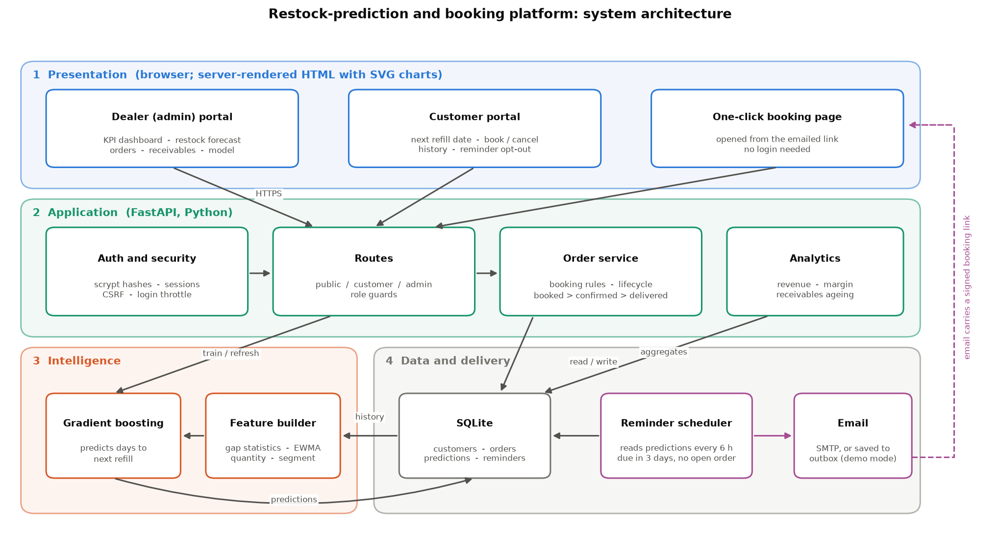

# Commercial Gas Agency — restock prediction, reminders & booking

Dealer (admin) and customer portals, an ML model that predicts when each commercial customer will need
their next cylinders, automated reminder emails with a one-click booking link, and a finance dashboard.

## Run

**Windows:** double-click **`run.bat`**. It needs Python 3.10+ (https://www.python.org/downloads/windows/,
tick "Add python.exe to PATH"). On first run it creates a virtual environment, installs the packages
(a few minutes), asks for your secret key and dealer login, starts the server and opens your browser.
Keep the black window open while you use the site; close it to stop. If port 8000 is busy, run
`set PORT=8001` in a command prompt first, then `run.bat`.

**macOS / Linux:** `sh run.sh` then open http://127.0.0.1:8000

Tests (any OS, after the first start has created `.venv`):
`pip install -r requirements-dev.txt` then `python -m pytest -q`

Research paper and the experiments behind it: see [`research/`](research/).

First start creates the database, **150 synthetic customers with ~24 months of orders**, trains the
model and computes predictions. Everything lives in `data/` (delete the folder to start over).
Products: 19 kg at ₹2,900 and 33 kg at ₹4,500 (cost prices are placeholders at ~10% below selling price).

**First start:** `sh run.sh` asks (in the terminal) for your secret key, dealer email and dealer password,
saves them to a git-ignored, owner-only `.env`, then starts the server. Later starts don't ask again.
Leave the key empty to generate a strong random one. To change them later:
`.venv/bin/python setup_env.py --force` (the dealer password only takes effect on a fresh `data/` folder,
since the admin account is created once; delete `data/` to apply a new one).

| Role | Login URL | Credentials |
|---|---|---|
| Dealer | `/admin/login` | the email and password you entered at setup (no OTP) |
| Customer | `/login` | `customer001@example.com` / `customer123` (…`customer150`) |

## What it does

- **Restock forecast** (`/admin/forecast`): predicted date, likely window and suggested quantity per customer.
- **Reminders**: when a customer is within `REMINDER_DAYS` (3) of their predicted date and has no open order,
  an email is sent once per cycle (checked every `REMINDER_CHECK_HOURS`, or press *Send due reminders*).
  The email holds a signed personal link (valid 14 days) to `/book/<token>`; no login is needed to book.
- **Customer portal**: next expected refill, book/cancel, history, outstanding balance, opt out of emails.
- **Admin dashboard**: revenue, gross profit and margin, cylinders, average cylinders per order and per
  customer per month, revenue per cylinder, receivables ageing, collections, segment and top-customer
  breakdowns, monthly trends.
- Marking an order *delivered* immediately recalculates that customer's next restock date.

## The ML model

Gradient boosting on the gaps between a customer's past deliveries, quantities, customer type and month.
It is trained on the earlier 80% of orders and scored on the later 20% (see `/admin/model`). On the
synthetic data its advantage over simple baselines is small, because the generated behaviour is fairly
regular (details and multi-seed results in the paper). Real-world accuracy will differ: retrain on real
orders once you have a few months of them. Customers with fewer than 3 deliveries fall back to a simple
average.

## Going live

Environment variables (all defined in `app/config.py`):

    SECRET_KEY=<long random string>   ADMIN_EMAIL=you@yourbusiness.com   ADMIN_PASSWORD=<strong>
    BASE_URL=https://your-domain      HTTPS_ONLY=1      BUSINESS_NAME="Your Agency"
    SMTP_HOST=smtp.gmail.com SMTP_PORT=587 SMTP_USER=... SMTP_PASSWORD=<app password> SMTP_FROM=...
    TEST_EMAIL_REDIRECT=you@yourbusiness.com   # optional: send ALL mail to yourself while testing

- Without `SMTP_HOST`, emails are saved to `data/outbox/*.eml` and listed under *Emails* in the admin.
  Addresses at example.com (the synthetic customers) are never sent to a real mail server.
- `ADMIN_EMAIL` / `ADMIN_PASSWORD` are only read when the admin account is first created, so set them
  before the first start.
- The synthetic customers can be replaced or retrained from the ML page; real customers are never touched.
